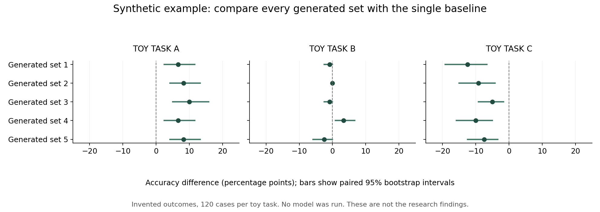

# Zero-shot Model Evaluation

Does using several text prompts improve a zero-shot model, and does it help consistently across tasks and groups?

This project looks at that question by keeping the image model and benchmark images fixed while changing how the text prompts are constructed. It brings together the study design, the mixed findings, and reusable code for comparing predictions on the same cases.

**[Study and findings](docs/STUDY.md)** · [Methods](docs/METHOD.md) · [Sources and code provenance](docs/SOURCES.md)

## The research in brief

The research compares a conventional single prompt, a human-written prompt ensemble, saved BLOOM-generated prompts, and five independently seeded Qwen3 prompt ensembles. CLIP and the image datasets stay fixed in the primary comparison.

The saved results do not point to one best method for every task:

- Qwen3 improved smiling-label accuracy against each baseline across all five prompt sets.
- Age-label results varied, and the historical BLOOM ensemble performed best.
- For the gender-label task, Qwen3 underperformed the single-prompt and BLOOM baselines.
- Better overall accuracy did not consistently mean smaller subgroup performance gaps.

These are findings about the evaluated models, prompts, and dataset annotations. The [study note](docs/STUDY.md) explains the comparisons and limits. This companion includes a narrative summary of the completed research; it does not distribute the underlying image datasets or original prediction outputs.

## Try the comparison method

The runnable example uses **invented numeric predictions**. It shows paired comparisons, all five generated-set results, and uncertainty without downloading a model or dataset. The deliberately different toy tasks illustrate improvement, mixed results, and deterioration.



**This figure is synthetic. It is not a plot of the CLIP, BLOOM, or Qwen3 research results.** Each toy task contains 120 invented cases; the bars show paired, label-stratified 95% bootstrap intervals. Variation across generated sets is shown separately.

Python 3.10+ and NumPy:

```bash
python -m pip install -e .
python -m unittest discover -s tests -v
python scripts/run_example.py
```

The example writes to `examples/output/`. The [committed summaries](examples/) let you inspect the example without running it. To rebuild the figure:

```bash
python -m pip install -e ".[figures]"
python scripts/plot_example.py
```

## What to inspect

| Material | Purpose |
| --- | --- |
| [Comparison code](zero_shot_evaluation/comparisons.py) | Resample candidate and baseline correctness as intact pairs |
| [Alignment checks](zero_shot_evaluation/analysis.py) | Reject duplicates, missing conditions, and inconsistent labels before comparison |
| [Metrics](zero_shot_evaluation/metrics.py) | Accuracy, confusion metrics, and interval helpers |
| [Synthetic generator](zero_shot_evaluation/synthetic.py) | Fixed-seed numeric examples with no images or participant records |
| [Tests](tests/test_evaluation.py) | Known contrasts, class weighting, missing pairs, and invalid inputs |

The underlying study credits Teresa Ristow and Ivan Hernandez. This public companion preserves selected analysis functions and adds a synthetic example and reader-facing documentation with AI assistance. The original research files remain separate and unchanged. See [code provenance and source terms](docs/SOURCES.md).
